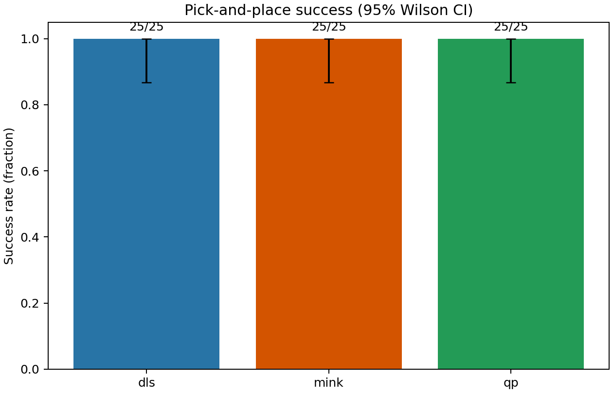
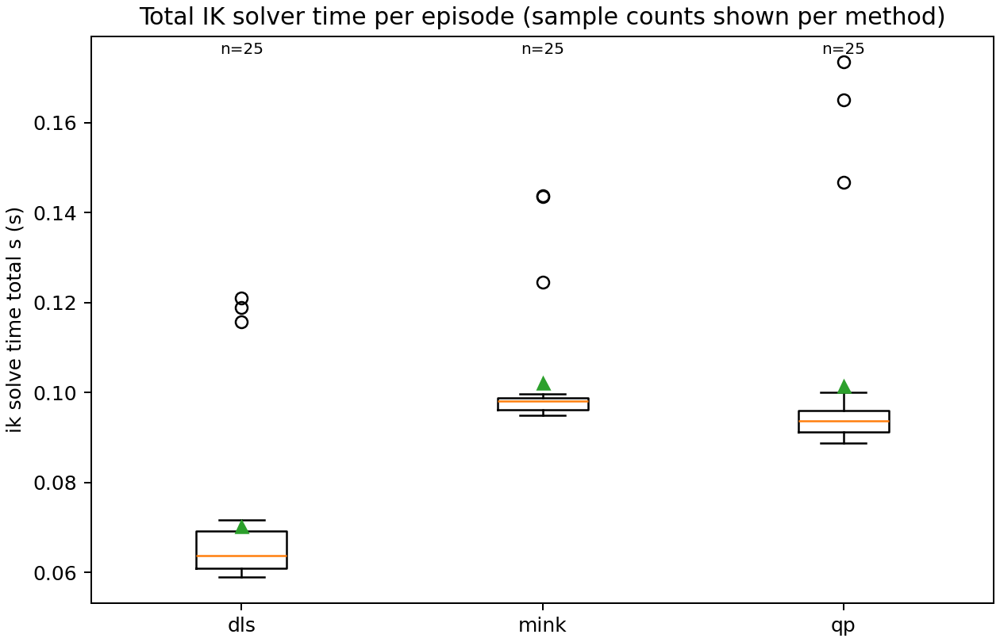
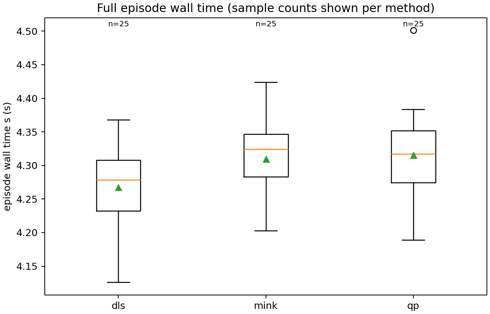
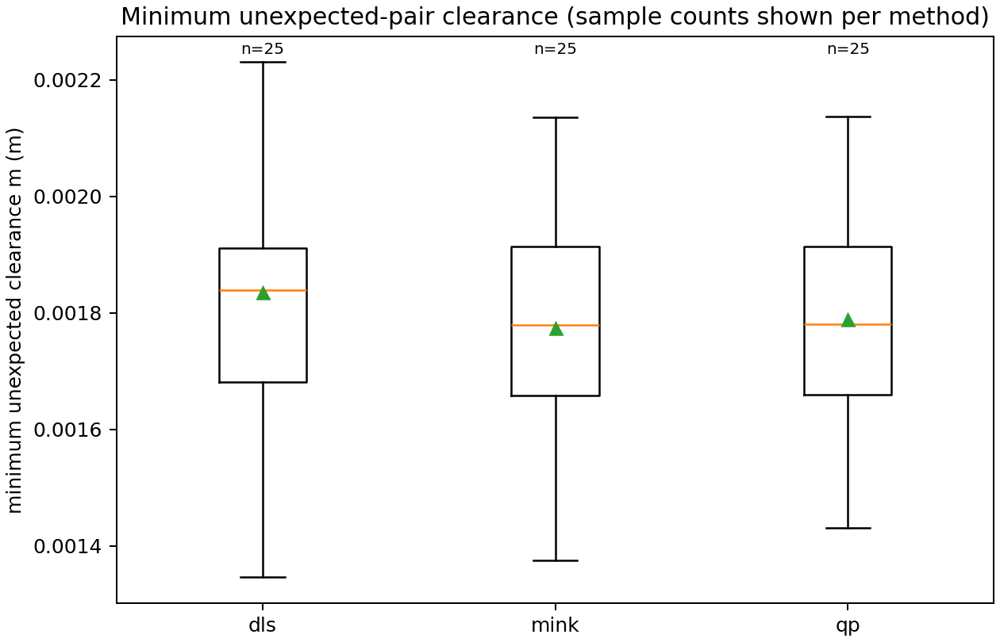
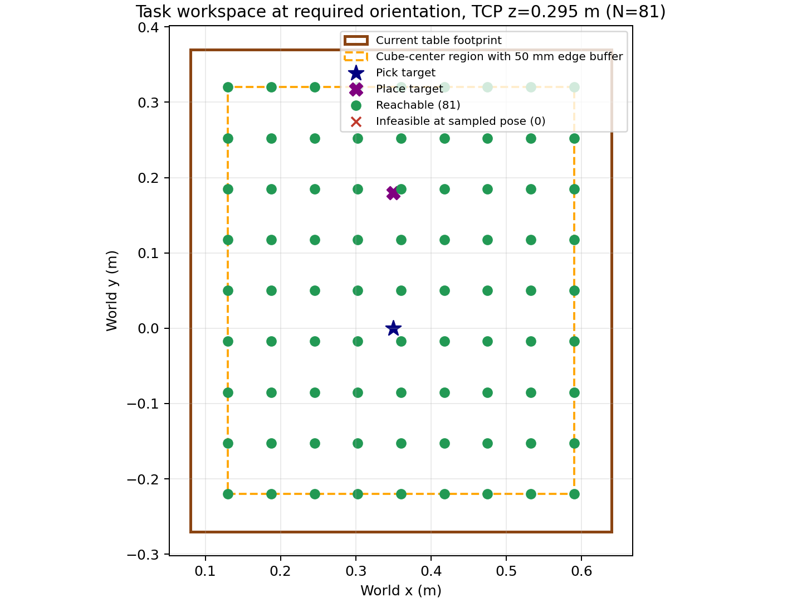
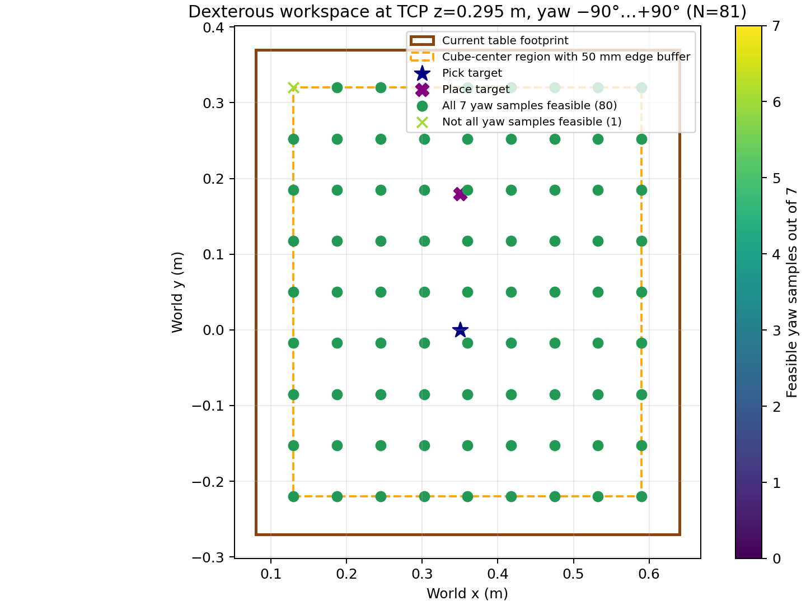

# HEAL Pick-and-Place with Three IK Methods

## 1. Goal and simulation setup

This project evaluates pick-and-place with a six-joint HEAL arm and Robotiq 2F-85 gripper in MuJoCo. The active model is [`robot_descriptions/arm_gripper.xml`](robot_descriptions/arm_gripper.xml); it uses the `right_center` site as the TCP and includes a static worktable and a free 4 cm cube. The table center is `[0.36, 0.05, 0.12] m`, its full dimensions are `[0.56, 0.64, 0.04] m` (x, y, z), and its top is at `z=0.14 m`. The nominal cube starts at `[0.35, 0.00, 0.165] m` and the target center is `[0.35, 0.18, 0.165] m`.

The preserved baseline in [`scripts/pick_and_place.py`](scripts/pick_and_place.py) uses custom damped least-squares IK and the existing gravity/bias-compensated joint PD torque tracker. It ramps joint targets through the same eight phases used by the comparison: approach, descend, close, lift, transfer, lower, release, retreat. Its nominal headless regression passes: the cube lifts and settles at `[0.35214, 0.17795, 0.15994] m` after `15.2 s` of simulation time. This matches the saved record in [`results/episodes.json`](results/episodes.json).

## 2. IK methods and evaluation

The comparable solvers in [`utils/ik_solvers.py`](utils/ik_solvers.py) control only the six HEAL arm joints; gripper and cube state remain in the same MuJoCo task. All methods use the same `right_center` pose targets and torque-tracking execution. DLS uses the damped Jacobian pseudoinverse update with damping `0.08` and clips each update to `0.035 rad`. Mink uses a differential `FrameTask`, DAQP, damping `1e-4`, model configuration limits, and a `1.2 rad/s` per-joint velocity limit. The custom QP minimizes weighted task velocity error with a `1e-4` regularizer and hard next-step joint-position and `1.2 rad/s` velocity bounds. The velocity cap is an evaluation setting, not a claimed HEAL hardware rating.

The Stage 3 batch in [`results_stage3/batch/episodes.jsonl`](results_stage3/batch/episodes.jsonl) contains 25 episodes per method, using the same seeds (`20261011`–`20261035`) and matched initial cube pose, yaw, pick, and placement target for every method. The manifest and metric definitions are in [`manifest.json`](results_stage3/batch/manifest.json) and [`summary.json`](results_stage3/batch/summary.json). Each episode resets the simulation and uses the same task phases and success rule. The final horizontal placement tolerance is **70 mm**, with final cube z in `[0.13, 0.22] m`; this is a broad task-level tolerance, not precision-placement evidence.

“IK time” below is the sum of wall-clock durations for that episode’s iterative solver calls. “Episode wall time” covers the complete episode, including simulation and collision measurements. Intervals are 95% bootstrap confidence intervals for means; success intervals are 95% Wilson intervals. `n=25` for each entry.

| Method | Success, Wilson 95% CI | Total IK time mean [95% CI] (s) | Full episode wall mean [95% CI] (s) |
|---|---:|---:|---:|
| DLS | 25/25 [0.867, 1.000] | 0.07035 [0.06411, 0.07786] | 4.26768 [4.24312, 4.29057] |
| Mink | 25/25 [0.867, 1.000] | 0.10223 [0.09761, 0.10787] | 4.30942 [4.28676, 4.33164] |
| QP | 25/25 [0.867, 1.000] | 0.10150 [0.09345, 0.11121] | 4.31531 [4.29225, 4.34107] |

All three methods succeeded in these 25 tested episodes; this does not guarantee future success. All measured joint-position-limit excursions were zero. Mink and QP had no meaningful measured velocity-limit violations against `1.2 rad/s` (reported residuals were about `10^-14 rad/s`). DLS does not enforce a time-based velocity cap, so its velocity-limit metric is unavailable, not zero. Internal backend iteration counts are unavailable. The reported outer update counts (mean: DLS 554.6, Mink 586.68, QP 592.44 per episode) are method-specific and are not equal units of computation.

There are 200 waypoint calls per method across the batch. `max_iterations` was reported for 56 DLS calls and 55 calls each for Mink and QP. These waypoints were still executed because their residuals passed the controller’s existing execution thresholds of `0.06 m` and `0.25 rad`; task success therefore does not mean every IK call converged to its stricter solver threshold.

The plots below are regenerated from the saved batch summary. The success-rate confidence intervals overlap fully; the small timing differences do not establish a universally best solver.

## 3. Workspace and table rationale

The workspace sampler in [`scripts/workspace_collision_audit.py`](scripts/workspace_collision_audit.py) solves endpoint IK with the model’s six joint ranges. It uses a deterministic grid over x `[0.08, 0.64] m`, y `[-0.27, 0.37] m`, and TCP z `[0.295, 0.415, 0.475] m`; the 50 mm edge-buffered table-center grid is x `[0.13, 0.59] m`, y `[-0.22, 0.32] m`. A sample passes when position residual is below `0.025 m` and orientation residual below `0.05 rad` (DLS damping `0.08`, maximum 180 updates). The recorded seed is 7; the grid itself uses no random samples.

Of 249 task samples, 248 passed. At TCP z `0.295 m`, all 81 regular buffered table-center points, including pick and place, passed. Of 1,743 sampled poses over seven yaw orientations from `−90°` to `+90°`, 1,735 passed. The dexterous summary reports 82/83 contact-height positions feasible at all seven yaws; its XY plot shows the 81-point regular grid (80/81). The extra exact task samples account for the denominator difference. Only sampled points are classified; unsampled positions are unknown.

The measured task grid supports retaining the existing 0.56×0.64 m table footprint for these sampled targets, with a cube-edge buffer. This is a workspace reachability recommendation only; it does not establish continuous path access, structural strength, load capacity, or collision-free coverage. No model table dimensions were changed.

Raw samples and thresholds are in [`workspace_samples.csv`](results_stage2/workspace_samples.csv) and [`workspace_summary.json`](results_stage2/workspace_summary.json). The 3D task plot is [`workspace_task_3d.png`](results_stage2/workspace_task_3d.png).

## 4. Collision measurements and Stage 4 segment rejection

Stage 2’s [`nominal_collision_smoke.json`](results_stage2/nominal_collision_smoke.json) is a passive audit: it recorded 7,600 steps, 494,000 distance queries across 65 monitored pair sets, and 77,565 expected contact observations. It recorded no unexpected actual contacts. The minimum measured clearance over unexpected pairs was `1.517 mm`. Repeated observations during physics steps are not distinct contact events. Passive contact/distance monitoring does not alter motion or enforce avoidance.

The opt-in Stage 4 controller in [`scripts/collision_aware_pick_place.py`](scripts/collision_aware_pick_place.py) adds a finite sampled joint-segment precheck and a runtime clearance/contact abort guard while retaining the baseline torque tracker. Its 25-point path checks reject a segment below a `0.75 mm` clearance margin. In [`collision_aware_smoke.json`](results_stage4/collision_aware_smoke.json), the nominal episode completed all eight phases with no unexpected actual contact or penetration observations. Its minimum planned-segment clearance was **0.793 mm**, only **0.043 mm** above the configured threshold. During executed simulation, the minimum unexpected-pair clearance was **1.517 mm**. These are simulation measurements, not hardware safety margins.

The nominal final cube x coordinate was `0.33192 m` versus target `0.35000 m`, an approximately **18 mm x offset**; it met the same broad placement acceptance. In the deliberately low-pick case, the approach completed but descent was rejected for `right_follower_tongue_collision` with the worktable. The candidate segment’s minimum signed clearance was `−31.598 mm`; the first sampled threshold crossing was `−0.051 mm`. The executed portion had no unexpected actual contacts. The figure [`segment_clearance.png`](results_stage4/segment_clearance.png) plots the six executed Cartesian refinement subsegments for that descent, not the rejected full candidate segment.

This is limited active segment rejection, not general or certified collision-free planning. Twenty-five samples can miss collisions between samples; there is no obstacle detour search or collision-constrained IK. The model has no tray geometry, so no tray avoidance is evaluated. Selected cube/gripper geometry pairs are excluded in some kinematic checks because the fixed held-cube proxy overlaps the finger envelope; actual runtime contacts are monitored separately. Expected support and grasp contacts are not treated as unexpected collisions.

## 5. Conclusion and remaining limits

The saved evidence supports successful HEAL pick-and-place in the nominal baseline and in 25 matched simulation episodes for each of DLS, Mink, and QP. It also supports sampled endpoint workspace reachability for the stated targets and shows that the Stage 4 controller can reject one deliberately unsafe descent. The data does not establish guaranteed success, precise placement, continuous workspace coverage, general collision avoidance, tray handling, or real-robot performance. The three-minute viewer demonstration video, with about one minute per IK method, remains outstanding. The current viewer runner is the original DLS script; the three-method smoke/batch runner is headless, so Mink/QP viewer footage requires a future viewer-capable demo runner.
